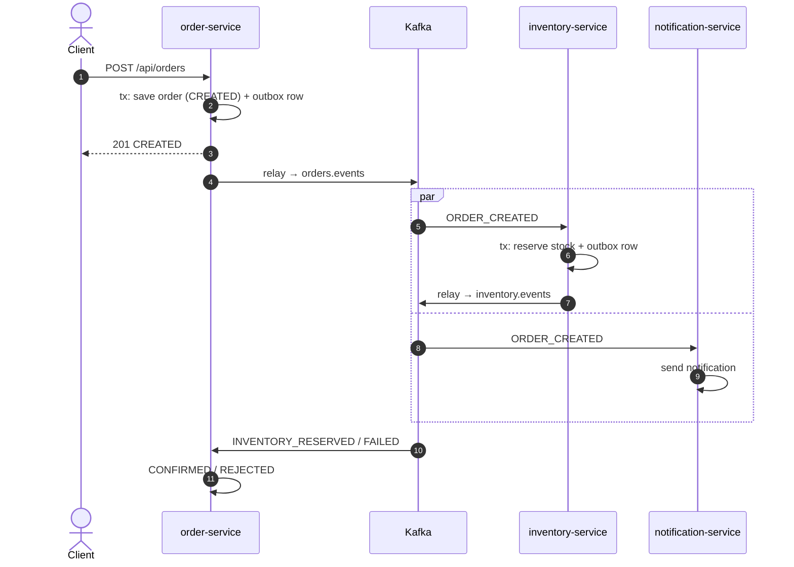
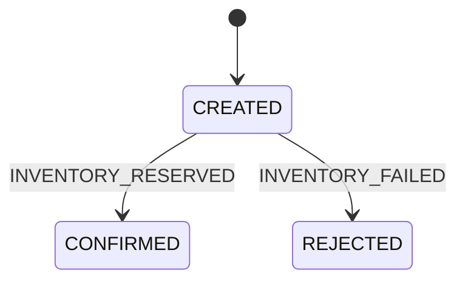
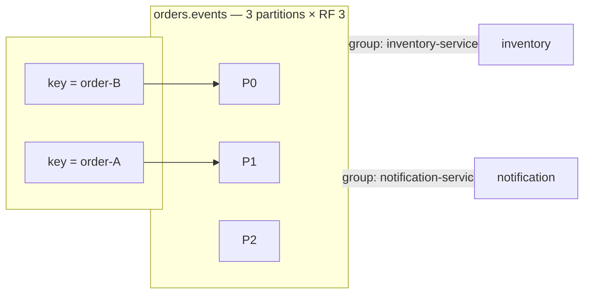
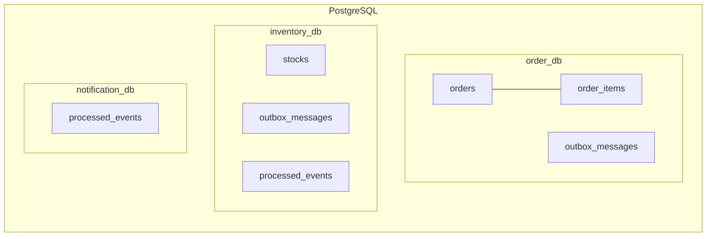
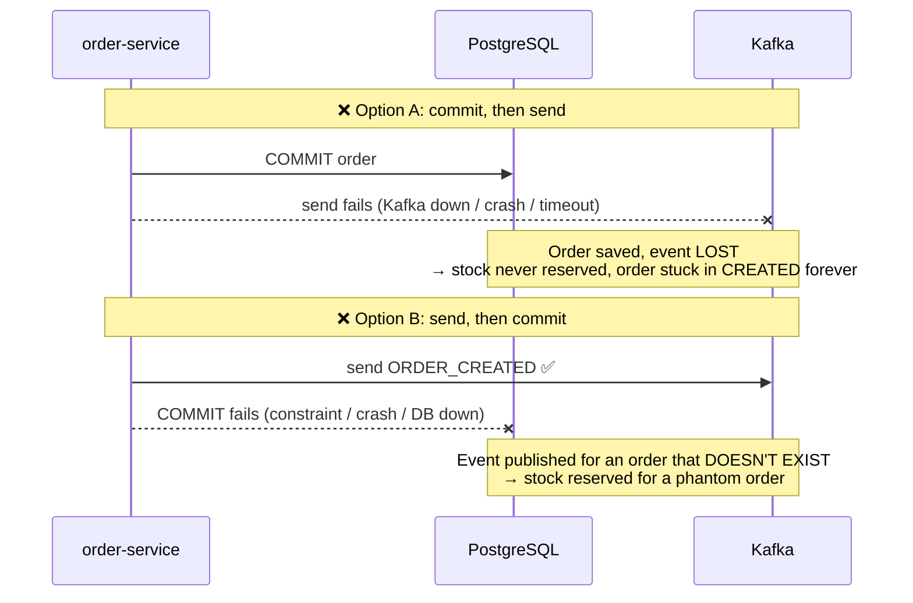
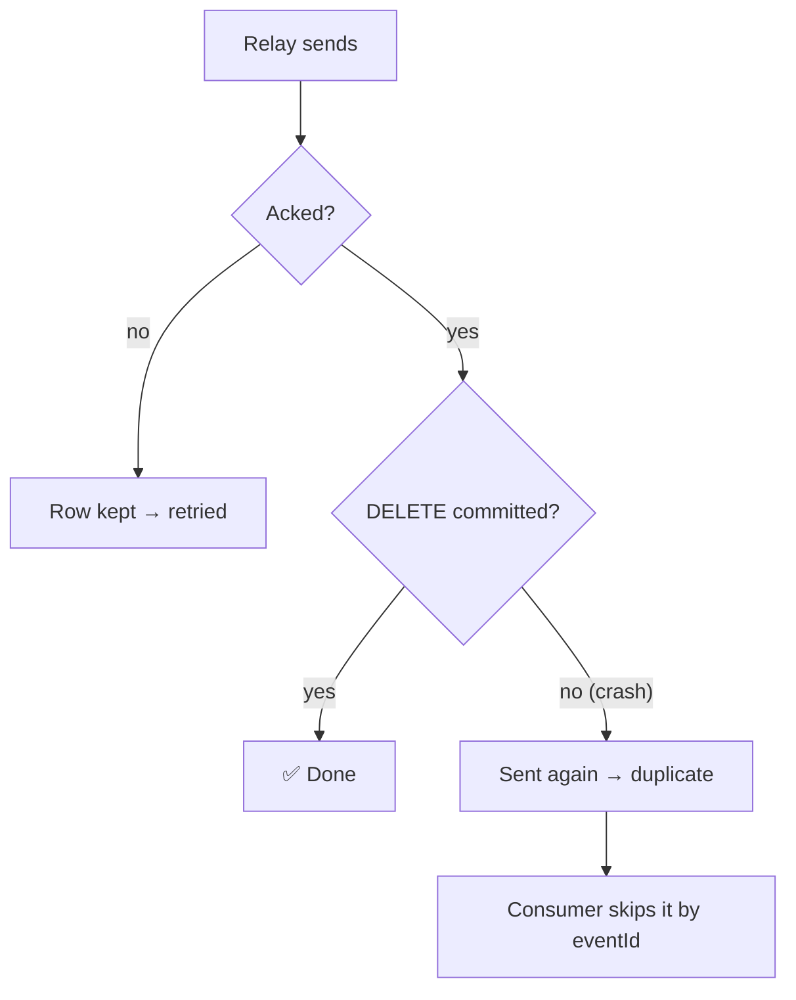
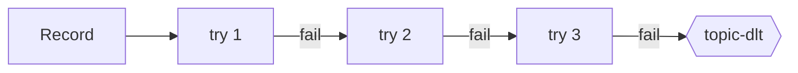
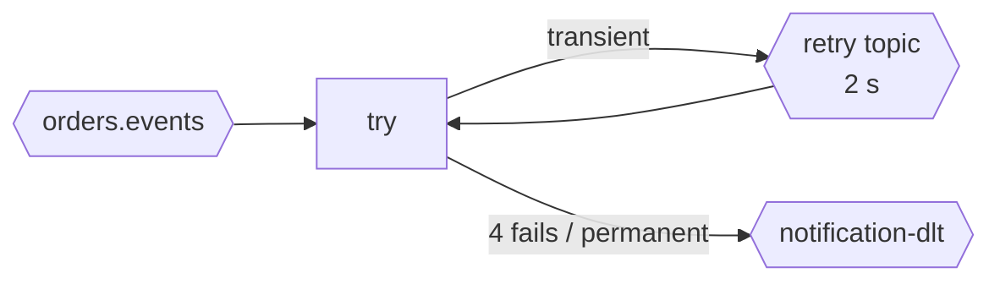
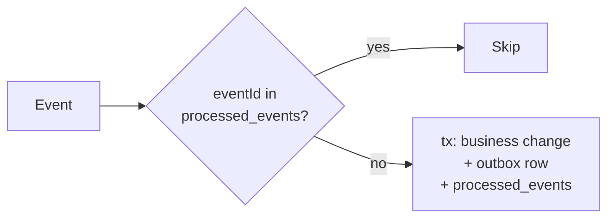
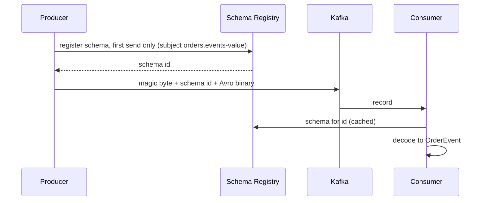

# Kafka & Spring Boot — Event-Driven Order System

3 Spring Boot microservices that talk **only through Kafka** (Avro + Schema Registry), each with **its own PostgreSQL database**, publishing through a **Transactional Outbox**.

**Contents:** [What we are building](#what-we-are-building) · [Prerequisites](#prerequisites) · [Learning goals](#learning-goals) · [1. Saga](#1-saga) · [2. Outbox](#2-transactional-outbox) · [3. Retries & DLQ](#3-retries--dlq) · [4. Delivery semantics](#4-delivery-semantics) · [5. Idempotent producer](#5-idempotent-producer) · [6. Idempotent consumers](#6-idempotent-consumers) · [7. Schema Registry & Avro](#7-schema-registry--avro) · [Run](#run)

## What we are building

An online shop's order flow: a customer places an order, the stock is reserved, the customer is notified.

Three services, each owning its database, never call each other: they only exchange events through Kafka. The hard part is not sending messages, it is keeping **three databases consistent without a distributed transaction**, while any process, broker or network link can fail at any time. Each pattern below answers one of those failures.

### Components

| Component | Responsibility | Produces | Consumes |
|---|---|---|---|
| **order-service** | REST API; creates the order, starts the saga, sets the final status | `orders.events` | `inventory.events` |
| **inventory-service** | Owns the stock; reserves all lines of an order or none | `inventory.events` | `orders.events` |
| **notification-service** | Notifies the customer; shows non-blocking retries + DLT | retry / DLT topics | `orders.events` |
| **avro-schemas** | `OrderEvent`, `InventoryResultEvent` contracts | | |
| **common** | Outbox, idempotency, error handling, shared config | | |
| **Kafka** ×4 | KRaft cluster (3 broker+controller, 1 broker), no ZooKeeper | | |
| **Schema Registry** | Stores Avro schemas, `FORWARD_TRANSITIVE` | | |
| **PostgreSQL** | One database per service | | |
| **Kafka UI** | Browse topics, messages, groups | | |

### Architecture


### Order flow





### Kafka setup



- **Key = `orderId`** → all events of an order on one partition, in order.
- **One consumer group per service** → each service gets every event.
- **`acks=all` + `min.insync.replicas=2` + RF 3** → no loss if a broker dies.

| Topic | From → To |
|---|---|
| `orders.events` | order → inventory, notification |
| `inventory.events` | inventory → order |
| `orders.events-dlt`, `inventory.events-dlt` | failed records (3 attempts) |
| `orders.events-notification-retry` / `-dlt` | notification retries / dead letters |

### Databases



- `outbox_messages` — events waiting to be published.
- `processed_events` — event IDs already handled (dedup).
- Schemas managed by Flyway (`V1` shared, `V2` per service).

## Prerequisites

Kafka basics, assumed known:

- **Topic → partitions**: an append-only log split into partitions; each record has an **offset**.
- **Record = key + value (+ headers)**: same key → same partition → ordered.
- **Producer**: writes records; `acks` says how many replicas must confirm.
- **Consumer group**: the partitions are shared among its members; each group gets every record; progress is the **committed offset**.
- **Replication**: replication factor (RF), in-sync replicas (ISR), `min.insync.replicas`.

## Learning goals

Go beyond the basics: the patterns that make event-driven services reliable.

| # | Pattern | Problem it solves |
|---|---|---|
| 1 | [Saga](#1-saga) | One business transaction spans 3 databases |
| 2 | [Transactional outbox](#2-transactional-outbox) | Save to the DB **and** publish to Kafka, atomically |
| 3 | [Retries & DLQ](#3-retries--dlq) | Handle failures without losing or blocking messages |
| 4 | [Delivery semantics](#4-delivery-semantics) | At-most / at-least / exactly once: which one, and its cost |
| 5 | [Idempotent producer](#5-idempotent-producer) | Producer retries must not duplicate records |
| 6 | [Idempotent consumers](#6-idempotent-consumers) | Redelivered events must be harmless |
| 7 | [Schema Registry & Avro](#7-schema-registry--avro) | A shared, evolvable contract between services |

## 1. Saga

A **saga** splits a business transaction into **local transactions, one per service**, chained by events. Each step commits on its own; there is no global rollback, so a failure is handled by a **compensating action** in a later step.

Ours is a **choreography** saga: no coordinator, each service reacts to the previous event.

| Step | Service | Local transaction | Emits |
|---|---|---|---|
| 1 | order | Save order `CREATED` | `ORDER_CREATED` |
| 2 | inventory | Reserve every line, or none | `INVENTORY_RESERVED` / `INVENTORY_FAILED` |
| 3 | order | `CONFIRMED` / `REJECTED` | — |

- **Compensation**: `REJECTED` is the compensation of step 1. Inventory reserves all-or-nothing in one transaction, so there is nothing to undo. With a later step that can fail (e.g. payment), inventory would need a compensating `RELEASE_STOCK`.
- **Eventual consistency**: between steps the order is visibly `CREATED`.

The other flavour is **orchestration**:

| | Choreography (ours) | Orchestration |
|---|---|---|
| Who drives | Each service reacts to events | A central orchestrator sends commands, handles replies |
| Where the flow lives | Spread across services | In one place |
| Fits | Few steps | Many steps, complex compensations |

## 2. Transactional outbox

### Without an outbox

The obvious code saves the order, then sends the event:

```java
@Transactional
public Order createOrder(CreateOrderRequest request) {
    orderRepository.save(order);                       // write 1: PostgreSQL
    kafkaTemplate.send("orders.events", id, event);    // write 2: Kafka
    return order;
}
```

That's two writes to **two different systems**, and nothing makes them atomic. Whichever order you put them in, a crash between them breaks something:



| Approach | What goes wrong |
|---|---|
| Commit, then send | **Lost event**: the order exists but nobody hears about it |
| Send, then commit | **Phantom event**: everyone hears about an order that was rolled back |
| Send inside `@Transactional` | Same as B: the send happens before the commit, and Kafka can't be rolled back |
| Retry the send in a loop | The process can still crash before retrying, and the retry state is lost with it |
| Kafka transactions | They make Kafka atomic with Kafka, **not** with PostgreSQL |

On top of that, the HTTP request becomes slow and fails whenever Kafka is down, even though the order itself could be saved.

### How we solved it

We don't send to Kafka in the request at all. The event is saved **as a row in the same database, in the same transaction** as the order, so there's only one system and the write is atomic. A background relay publishes it afterwards.




| | Without outbox | With outbox |
|---|---|---|
| Order saved, event lost | possible | ❌ impossible: same commit |
| Event for a rolled-back order | possible | ❌ impossible: rolled back together |
| Kafka down | request fails | ✅ request succeeds, event sent when Kafka is back |
| Duplicates | possible | possible, harmless: consumers skip them by `eventId` |

**Never lost, never phantom, maybe duplicated → consumers are idempotent.**

Code: [OutboxWriter](common/src/main/java/com/example/kafka/common/outbox/OutboxWriter.java) (`MANDATORY`: must join the business transaction) · [OutboxRelay](common/src/main/java/com/example/kafka/common/outbox/OutboxRelay.java) (runs never overlap: each run first takes a PostgreSQL advisory lock, `pg_try_advisory_xact_lock`, and if another instance holds it the run is skipped). Watch it: stop Kafka, create orders, see `GET /api/orders/outbox/pending` fill up; restart Kafka and it drains.

## 3. Retries & DLQ

A failed record is retried; if it keeps failing, it goes to a **dead-letter topic (DLT)** so it is kept for inspection and stops blocking. Two strategies:

**Blocking** (order, inventory): the partition waits, so the order of events is preserved; required by the saga. 3 attempts, 1 s apart ([KafkaErrorHandlingConfig](common/src/main/java/com/example/kafka/common/kafka/KafkaErrorHandlingConfig.java)), then `<topic>-dlt`, same partition.



**Non-blocking** (notification): the failed record moves to a retry topic and the partition keeps flowing; order does not matter for notifications. 4 attempts, 2 s apart (`@RetryableTopic` in [NotificationConsumer](notification-service/src/main/java/com/example/kafka/notification/consumer/NotificationConsumer.java)). A permanent error skips the retries.



- **Poison pills** (records that cannot be deserialized) go straight to the DLT: retrying cannot fix them.
- Demo: customer `flaky_*` fails twice then succeeds; `invalid_*` goes straight to the DLT.

## 4. Delivery semantics

| Semantics | How | Risk |
|---|---|---|
| At most once | Commit the offset **before** processing; producer without retries | Loss |
| **At least once** (ours) | Process, **then** commit the offset; producer retries until acked | Duplicates |
| Exactly once | Kafka transactions (read-process-write) | Only covers Kafka → Kafka, not our PostgreSQL writes |

Spring commits the offset after the listener returns, and the outbox relay deletes a row only once Kafka acked it. So nothing is lost, but **duplicates happen**:

- The relay sent a batch, then crashed before deleting the rows → the batch is sent again.
- A consumer committed its DB transaction, then crashed before committing the offset → the record is redelivered.
- A rebalance hands a partition over before its offset was committed → the new owner reprocesses it.

**At-least-once + idempotent consumers = effectively once.**

## 5. Idempotent producer

**Problem**: the broker writes a record but the ack is lost; the producer retries and the record is written twice. With several requests in flight, a retry can also reorder records.

**Fix**: each producer gets an id and numbers its records per partition; the broker drops a sequence number it already has and rejects gaps.

| Config | Value | Here |
|---|---|---|
| `enable.idempotence` | `true` | Default since Kafka 3.0 |
| `acks` | `all` (required) | Set in [common-defaults.yml](common/src/main/resources/common-defaults.yml) |
| `retries` | `> 0` | Default `Integer.MAX_VALUE` |
| `max.in.flight.requests.per.connection` | `≤ 5` | Default `5`; order still kept |

- If a conflicting setting is added (e.g. `acks=1`) and `enable.idempotence` is not set explicitly, idempotence is **silently disabled**; set to `true` explicitly, the producer fails at startup instead.
- **Limit**: deduplication works within one producer session. After a restart the producer has a new id, so the relay re-sending a batch after a crash is **not** caught: that's the consumers' job. Across sessions, Kafka needs a `transactional.id`.

## 6. Idempotent consumers

Processing the same event twice must have the same effect as processing it once.



| Service | Technique | Why it holds |
|---|---|---|
| inventory | `processed_events` row in the same transaction as the stock change and the outbox row | Marker and effect commit together, or not at all |
| notification | `processed_events` | The send itself is outside the DB: a crash between send and commit can still notify twice |
| order | State machine: only `CREATED` can change | A second result finds `CONFIRMED`/`REJECTED`: no-op |

- Dedupe on **`eventId`** (a UUID set when the event is created), not on the offset: a record re-sent by the relay gets a new offset.
- The marker must be written **in the same transaction** as the effect; otherwise a crash leaves one without the other.

## 7. Schema Registry & Avro

Services share **contracts**, not code: the Avro schemas in [avro-schemas](avro-schemas/src/main/avro) (`OrderEvent`, `InventoryResultEvent`), compiled to Java classes at build time.



- **Avro**: compact binary; the schema travels as a 4-byte id, not with every record.
- **Compatibility `FORWARD_TRANSITIVE`**: every new schema must be readable by consumers on **any** older version, so producers can upgrade first. Adding a field or removing one that has a default is allowed; removing a field without a default or changing a type incompatibly is rejected at registration.
- Optional fields are unions with a default, e.g. `reason: ["null", "string"]`, default `null`.
- A record that does not match its schema is a poison pill → DLT ([3](#3-retries--dlq)).

## Run

Requires Docker (your user in the `docker` group), Java 21, Maven 3.9, `make`; `curl` and `jq` for `make demo`, Node 18+ for `make ui`.

### Quick start

```bash
make start
```

This one command starts the infrastructure in Docker (Kafka, Schema Registry, PostgreSQL, Kafka UI), builds every module, starts the three services as local JVMs, waits until they are all healthy, then serves the scenario UI on http://localhost:5173. `Ctrl+C` stops the UI only; the services keep running until `make down`.

Without the UI, `make up` does the same and returns; run `make demo` for the scenarios in the terminal.

To run the services from your IDE instead, start only the infrastructure with `make infra`, then run each `*Application` class.

### All targets

```bash
make start  # make up, then make ui
make up     # infrastructure in Docker, services as local JVMs (logs in logs/)
make demo   # end-to-end scenarios
make ui     # scenario UI with each order's path through the services and topics: http://localhost:5173
make logs
make down   # stop the services and reset the infrastructure
make test   # starts the compose PostgreSQL; tests use the *_test databases
```

| Demo | Result |
|---|---|
| Order 2 (stock 5) | `CONFIRMED` |
| Order 10 | `REJECTED` |
| Customer `flaky_*` | retried, then notified |
| Customer `invalid_*` | sent to DLT |

| URL | |
|---|---|
| Scenario UI | http://localhost:5173 (`make ui`) |
| Orders | http://localhost:8080/api/orders (`/outbox/pending`) |
| Inventory | http://localhost:8082/api/inventory |
| Kafka UI | http://localhost:8090 |
| Schema Registry | http://localhost:8081 |
| Kafka | localhost:9092, 9094, 9095, 9096 |
| PostgreSQL | localhost:5432 (postgres / postgres) |
