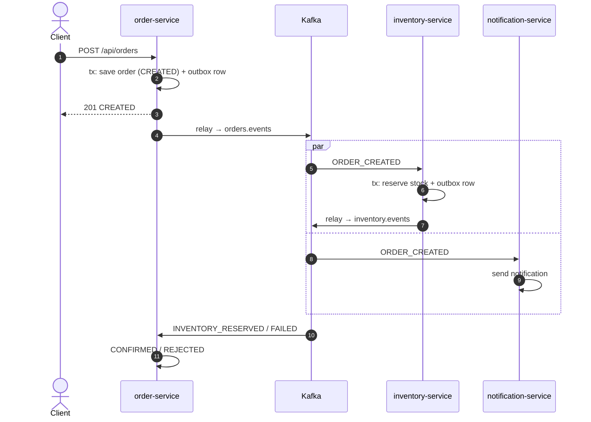
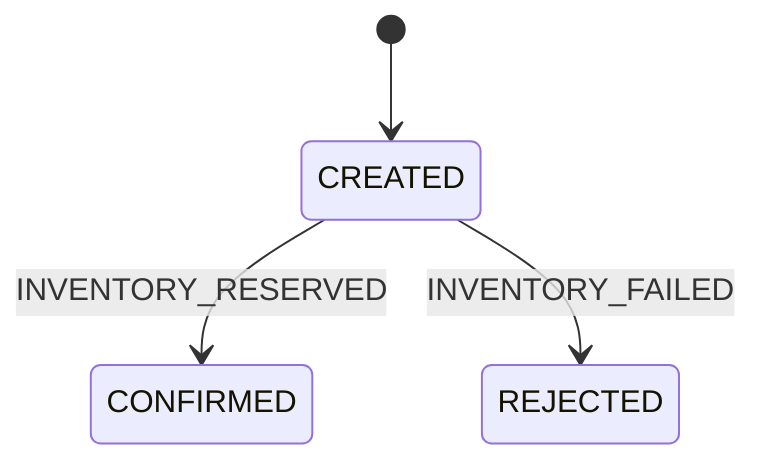
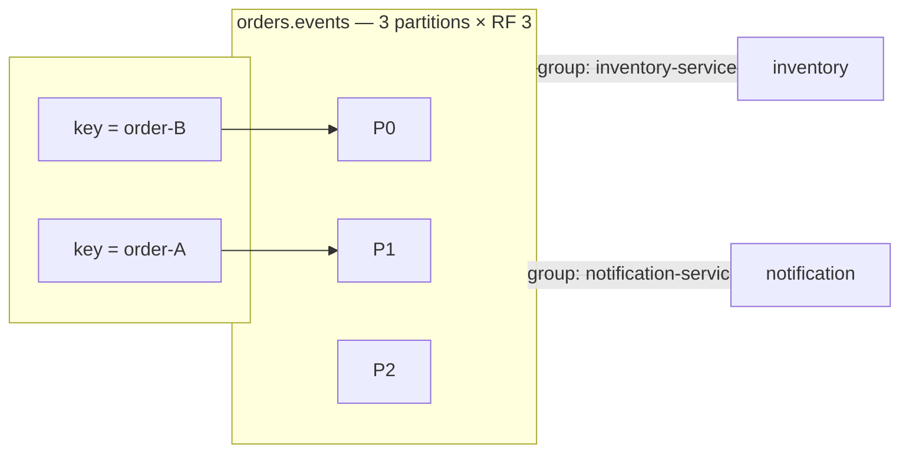
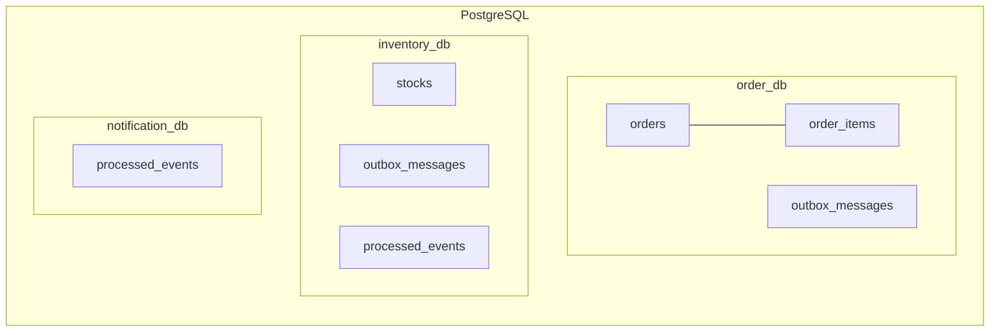
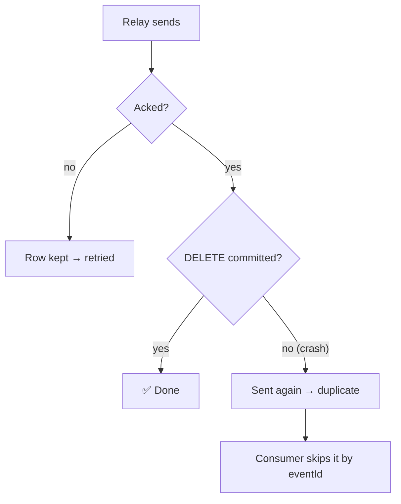
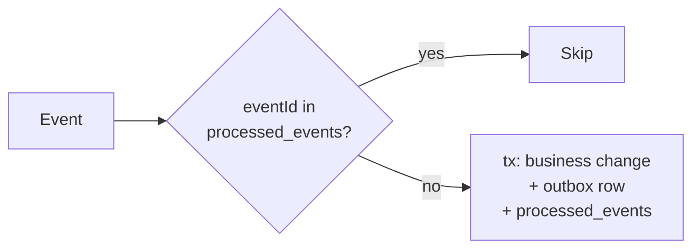
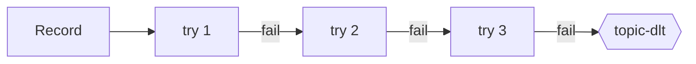
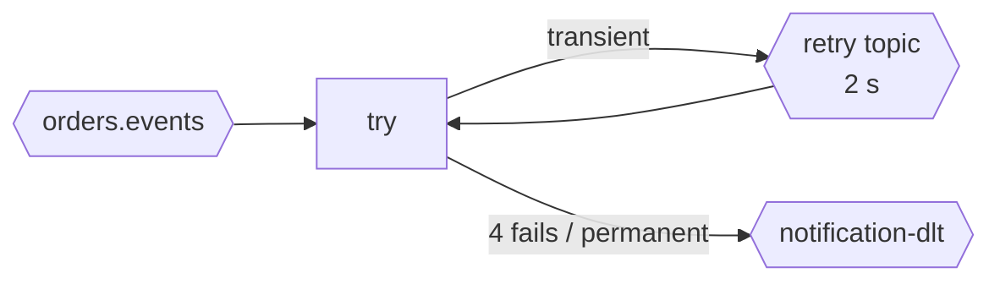

# Kafka & Spring Boot — Event-Driven Order System

3 Spring Boot microservices that talk **only through Kafka** (Avro + Schema Registry), each with **its own PostgreSQL database**, publishing through a **Transactional Outbox**.

## Architecture


## Components

| Component | Role | Produces | Consumes |
|---|---|---|---|
| **order-service** | REST API, creates orders, sets final status | `orders.events` | `inventory.events` |
| **inventory-service** | Reserves stock (all lines or none) | `inventory.events` | `orders.events` |
| **notification-service** | Notifies customer, demos retry topic + DLT | retry / DLT topics | `orders.events` |
| **avro-schemas** | `OrderEvent`, `InventoryResultEvent` contracts | | |
| **common** | Outbox, idempotency, error handling, shared config | | |
| **Kafka** ×4 | KRaft cluster (3 broker+controller, 1 broker), no ZooKeeper | | |
| **Schema Registry** | Stores Avro schemas, `FORWARD_TRANSITIVE` | | |
| **PostgreSQL** | One database per service | | |
| **Kafka UI** | Browse topics, messages, groups | | |

## Order flow





## Kafka



- **Key = `orderId`** → all events of an order on one partition, in order.
- **One consumer group per service** → each service gets every event.
- **`acks=all` + `min.insync.replicas=2` + RF 3** → no loss if a broker dies.

| Topic | From → To |
|---|---|
| `orders.events` | order → inventory, notification |
| `inventory.events` | inventory → order |
| `orders.events-dlt`, `inventory.events-dlt` | failed records (3 attempts) |
| `orders.events-notification-retry` / `-dlt` | notification retries / dead letters |

## Databases



- `outbox_messages` — events waiting to be published.
- `processed_events` — event IDs already handled (dedup).
- Schemas managed by Flyway (`V1` shared, `V2` per service).

## Transactional Outbox

**Problem:** saving to the DB and sending to Kafka can't be atomic → crash in between = lost or phantom event.

**Solution:** save the event in the DB **in the same transaction**, publish it later.




**Never lost, maybe duplicated → consumers are idempotent.**

## Idempotent consumers



- **inventory / notification** → `processed_events` table.
- **order** → state machine (only `CREATED` can change).

## Error handling

**Blocking** (order, inventory) — partition waits, order preserved:



**Non-blocking** (notification) — partition keeps flowing:



Poison pills (undeserializable messages) go straight to the DLT.

## Run

Requires Docker, Java 21, Maven 3.9, `make`, `curl`, `jq`.

```bash
make up     # everything in containers
make demo   # end-to-end scenarios
make logs
make down   # reset everything
make test   # no Docker needed
```

| Demo | Result |
|---|---|
| Order 2 (stock 5) | `CONFIRMED` |
| Order 10 | `REJECTED` |
| Customer `flaky_*` | retried, then notified |
| Customer `invalid_*` | sent to DLT |

| URL | |
|---|---|
| Orders | http://localhost:8080/api/orders (`/outbox/pending`) |
| Inventory | http://localhost:8082/api/inventory |
| Kafka UI | http://localhost:8090 |
| Schema Registry | http://localhost:8081 |
| Kafka | localhost:9092, 9094, 9095, 9096 |
| PostgreSQL | localhost:5432 (postgres / postgres) |
