# Kafka & Spring Boot — Event-Driven Order System

3 Spring Boot microservices that talk **only through Kafka**, each with **its own PostgreSQL database**.

**Contents:** [What we are building](#what-we-are-building) · [Prerequisites](#prerequisites) · [Learning goals](#learning-goals) · [1. Saga](#1-saga) · [2. Outbox](#2-transactional-outbox) · [3. Retries & DLQ](#3-retries--dlq) · [4. Delivery semantics](#4-delivery-semantics) · [5. Idempotent producer](#5-idempotent-producer) · [6. Idempotent consumers](#6-idempotent-consumers) · [7. Schema Registry & Avro](#7-schema-registry--avro) · [Run](#run)

## What we are building

An online shop's order flow: **place an order → reserve the stock → notify the customer.**

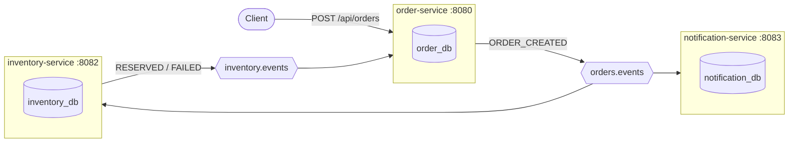

### Components

| Component | Responsibility | Produces | Consumes |
|---|---|---|---|
| **order-service** | REST API; creates the order, sets its final status | `orders.events` | `inventory.events` |
| **inventory-service** | Owns the stock; reserves an order's lines | `inventory.events` | `orders.events` |
| **notification-service** | Notifies the customer | | `orders.events` |
| **avro-schemas** | Event contracts: `OrderEvent`, `InventoryResultEvent` | | |
| **common** | Kafka and database code shared by the services | | |
| **Kafka** ×4 | KRaft cluster (3 broker+controller, 1 broker), no ZooKeeper | | |
| **Schema Registry** | Stores the event schemas | | |
| **PostgreSQL** | One database per service | | |
| **Kafka UI** | Browse topics, messages, groups | | |

### Order flow

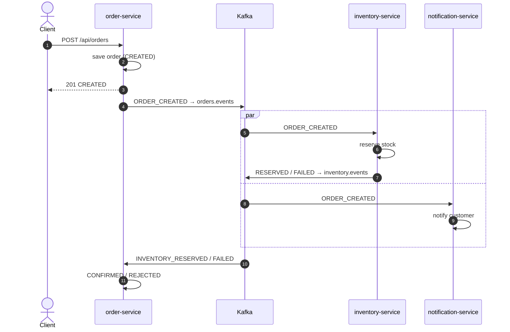

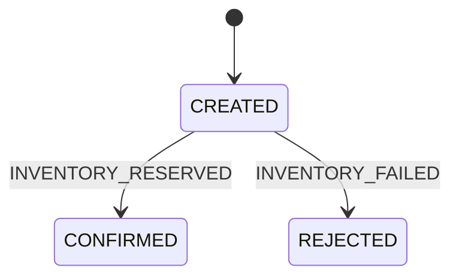

### Kafka setup

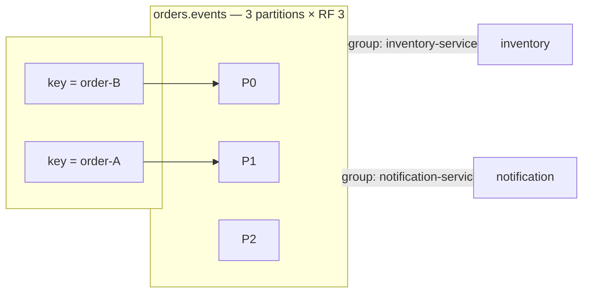

- **Key = `orderId`** → all events of an order on one partition, in order.
- **One consumer group per service** → each service gets every event.
- **`acks=all` + `min.insync.replicas=2` + RF 3** → no loss if a broker dies.

### Databases

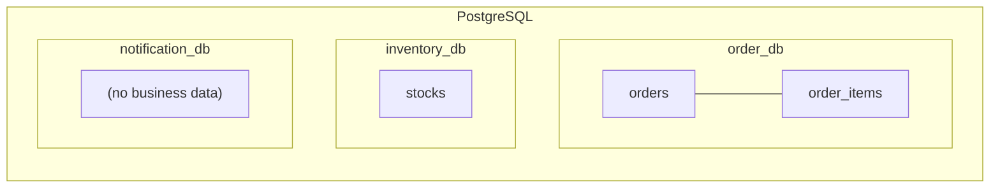

No service reads another's database. Schemas are managed by Flyway (`V1` shared, `V2` per service). The pattern tables (`outbox_messages`, `processed_events`) are introduced in their sections.

## Prerequisites

Kafka basics, assumed known:

- **Topic → partitions**: an append-only log split into partitions; each record has an **offset**.
- **Record = key + value (+ headers)**: same key → same partition → ordered.
- **Producer**: writes records; `acks` says how many replicas must confirm.
- **Consumer group**: the partitions are shared among its members; each group gets every record; progress is the **committed offset**.
- **Replication**: replication factor (RF), in-sync replicas (ISR), `min.insync.replicas`.

## Learning goals

Three databases must stay consistent **without a distributed transaction**, while any process, broker or network link can fail. Each pattern answers one failure:

| # | Pattern | Problem it solves |
|---|---|---|
| 1 | [Saga](#1-saga) | One business transaction spans 3 databases |
| 2 | [Transactional outbox](#2-transactional-outbox) | Save to the DB **and** publish to Kafka, atomically |
| 3 | [Retries & DLQ](#3-retries--dlq) | Handle failures without losing or blocking messages |
| 4 | [Delivery semantics](#4-delivery-semantics) | At-most / at-least / exactly once: which one, and its cost |
| 5 | [Idempotent producer](#5-idempotent-producer) | Producer retries must not duplicate records |
| 6 | [Idempotent consumers](#6-idempotent-consumers) | Redelivered events must be harmless |
| 7 | [Schema Registry & Avro](#7-schema-registry--avro) | A shared, evolvable contract between services |

## 1. Saga

**Technique:** a business transaction split into **local transactions, one per service**, chained by events. No global rollback: a failure is handled by a **compensating** step.

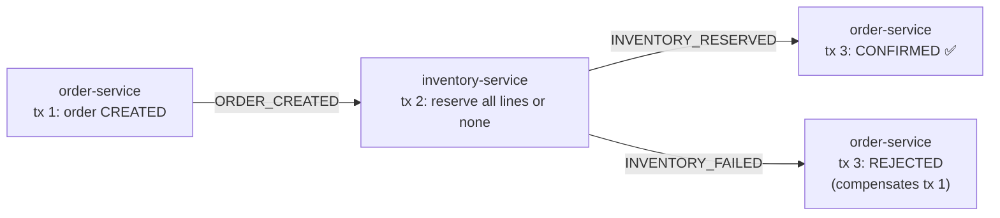

**Why:** each service owns its database, so one ACID transaction across the three is impossible.

- Nothing to undo in inventory: it reserves all-or-nothing in one transaction. A later failing step (e.g. payment) would need a compensating `RELEASE_STOCK`.
- Eventual consistency: between steps the order is visibly `CREATED`.

**Two flavours.** Ours is **choreography**: each service reacts to events.

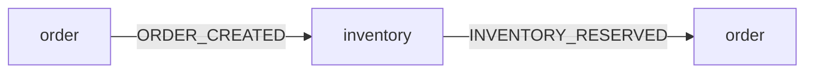

**Orchestration**: a coordinator sends commands and handles the replies.

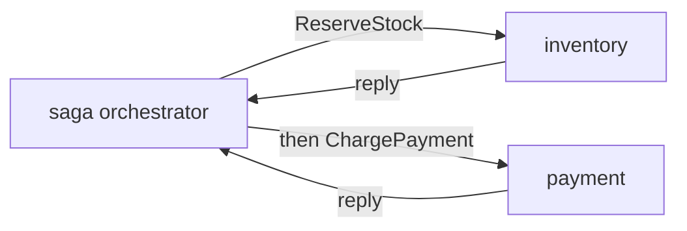

| | Choreography (ours) | Orchestration |
|---|---|---|
| Flow lives | Spread across services | In one place |
| Fits | Few steps | Many steps, complex compensations |

## 2. Transactional outbox

**Problem:** saving the order and sending the event are two writes to **two systems**; nothing makes them atomic.

```java
@Transactional
public Order createOrder(CreateOrderRequest request) {
    orderRepository.save(order);                       // write 1: PostgreSQL
    kafkaTemplate.send("orders.events", id, event);    // write 2: Kafka
    return order;
}
```

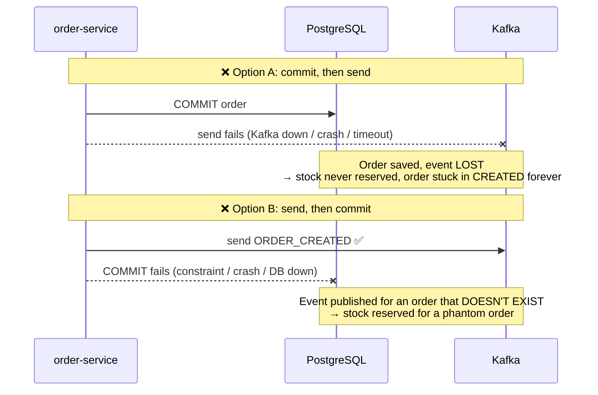

| Approach | What goes wrong |
|---|---|
| Commit, then send | **Lost event**: the order exists but nobody hears about it |
| Send, then commit | **Phantom event**: everyone hears about an order that was rolled back |
| Send inside `@Transactional` | Same as B: the send happens before the commit, and Kafka can't be rolled back |
| Retry the send in a loop | The process can still crash before retrying, and the retry state is lost with it |
| Kafka transactions | They make Kafka atomic with Kafka, **not** with PostgreSQL |

Also: the HTTP request becomes slow, and fails whenever Kafka is down.

**Technique:** write the event **as a row in the same database, in the same transaction** as the order (one system → atomic). A background relay publishes it afterwards.

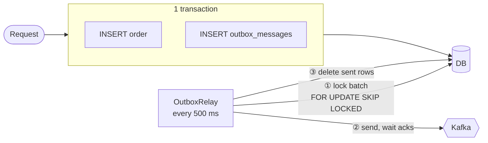

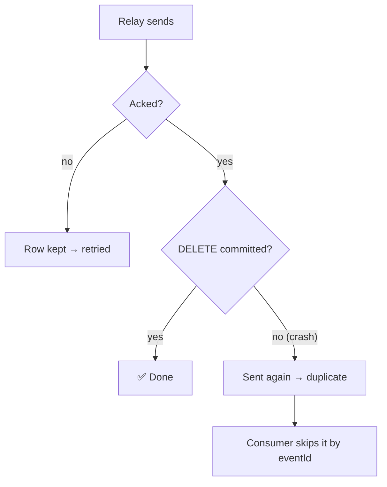

| | Without outbox | With outbox |
|---|---|---|
| Order saved, event lost | possible | ❌ impossible: same commit |
| Event for a rolled-back order | possible | ❌ impossible: rolled back together |
| Kafka down | request fails | ✅ request succeeds, event sent when Kafka is back |
| Duplicates | possible | possible, harmless: consumers skip them by `eventId` |

**Never lost, never phantom, maybe duplicated → consumers are idempotent.**

- `outbox_messages` (order_db, inventory_db): events waiting to be published.
- [OutboxWriter](common/src/main/java/com/example/kafka/common/outbox/OutboxWriter.java): `MANDATORY`, must join the business transaction.
- [OutboxRelay](common/src/main/java/com/example/kafka/common/outbox/OutboxRelay.java): runs never overlap; each run first takes a PostgreSQL advisory lock (`pg_try_advisory_xact_lock`) and is skipped if another instance holds it.
- Watch it: stop Kafka, create orders, see `GET /api/orders/outbox/pending` fill up; restart Kafka and it drains.

## 3. Retries & DLQ

**Technique:** retry a failed record; if it keeps failing, park it on a **dead-letter topic (DLT)** for inspection.

**Why:** a failing record must neither be lost nor block the records behind it forever.

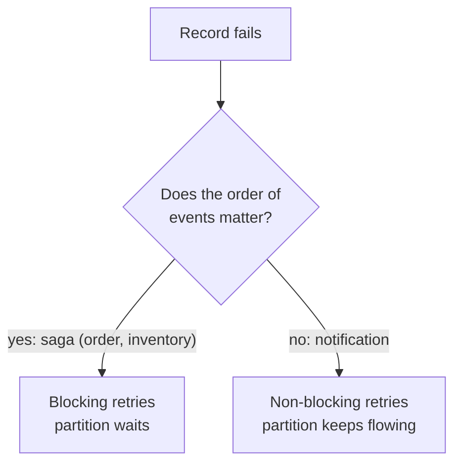

**Blocking** (order, inventory): 3 attempts, 1 s apart ([KafkaErrorHandlingConfig](common/src/main/java/com/example/kafka/common/kafka/KafkaErrorHandlingConfig.java)), then `<topic>-dlt`, same partition.

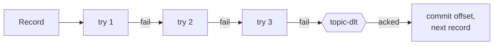

**Non-blocking** (notification): 4 attempts, 2 s apart, through a retry topic (`@RetryableTopic` in [NotificationConsumer](notification-service/src/main/java/com/example/kafka/notification/consumer/NotificationConsumer.java)). A permanent error skips the retries.

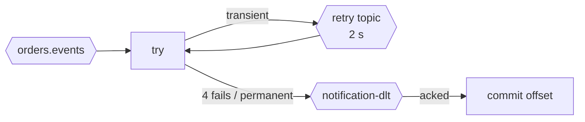

| Topic | Holds |
|---|---|
| `orders.events-dlt`, `inventory.events-dlt` | Records that failed 3 blocking attempts |
| `orders.events-notification-retry` | Notifications waiting for their next attempt |
| `orders.events-notification-dlt` | Notifications that failed 4 times, or permanently |

- **Retries exhausted → DLT → commit**: once the DLT acknowledged the record, its offset is committed and the partition moves on. If the DLT publication itself fails, nothing is committed and the record is retried: never dropped.
- **Poison pills** (records that cannot be deserialized) go straight to the DLT, as their original bytes ([AvroOrBytesSerializer](common/src/main/java/com/example/kafka/common/kafka/AvroOrBytesSerializer.java)): retrying cannot fix them, and Avro-encoding them would register a `bytes` schema that then rejects every real record on that DLT.
- Demo: customer `flaky_*` fails twice then succeeds; `invalid_*` goes straight to the DLT.

## 4. Delivery semantics

When does the consumer commit its offset, relative to processing? A crash in between decides the guarantee:

**At most once**: commit, then process.

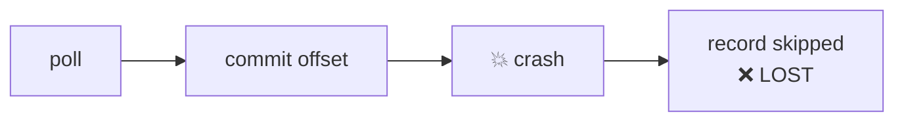

**At least once** (ours): process, then commit.

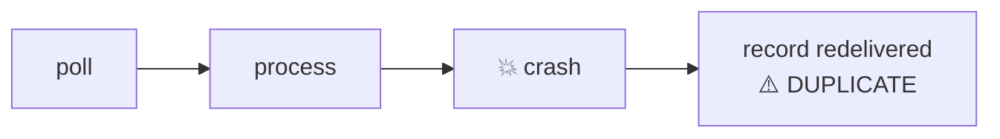

| Semantics | How | Risk |
|---|---|---|
| At most once | Commit the offset **before** processing; producer without retries | Loss |
| **At least once** (ours) | Process, **then** commit the offset; producer retries until acked | Duplicates |
| Exactly once | Kafka transactions (read-process-write) | Only covers Kafka → Kafka, not our PostgreSQL writes |

**Why at-least-once:** losing an order is not acceptable; a duplicate can be made harmless. Spring commits the offset after the listener returns, and the relay deletes a row only once Kafka acked it.

Where duplicates come from here:

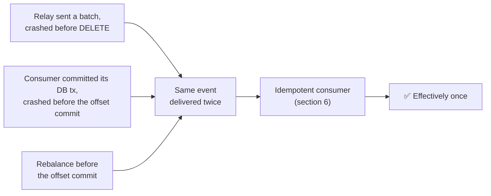

## 5. Idempotent producer

**Problem:** the broker writes a record, the ack is lost, the producer retries → the record is written twice.

**Technique:** each producer gets an id and numbers its records per partition; the broker drops a sequence number it already has.

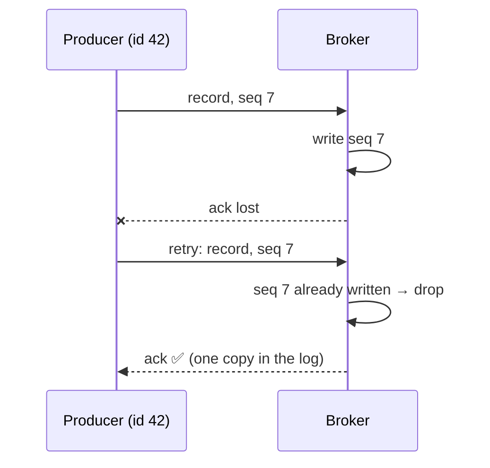

| Config | Value | Here |
|---|---|---|
| `enable.idempotence` | `true` | Default since Kafka 3.0 |
| `acks` | `all` (required) | Set in [common-defaults.yml](common/src/main/resources/common-defaults.yml) |
| `retries` | `> 0` | Default `Integer.MAX_VALUE` |
| `max.in.flight.requests.per.connection` | `≤ 5` | Default `5`; order still kept |

- If a conflicting setting is added (e.g. `acks=1`) and `enable.idempotence` is not set explicitly, idempotence is **silently disabled**; set to `true` explicitly, the producer fails at startup instead.
- **Limit:** works within one producer session. After a restart the producer has a new id, so the relay re-sending a batch after a crash is **not** caught: that's the consumers' job. Across sessions, Kafka needs a `transactional.id`.

## 6. Idempotent consumers

**Technique:** remember what was processed, and skip it the second time.

**Why:** at-least-once delivers duplicates; processing an event twice must have the same effect as once.

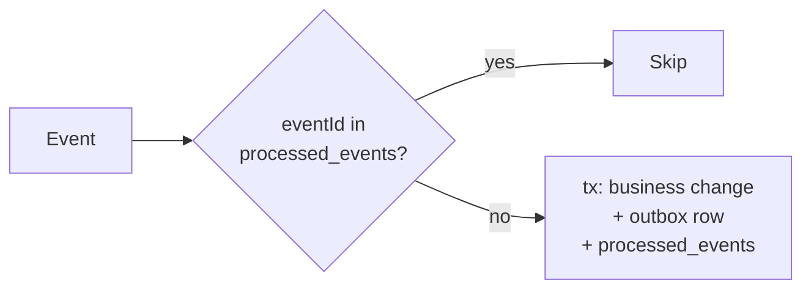

| Service | Technique | Why it holds |
|---|---|---|
| inventory | `processed_events` row in the same transaction as the stock change and the outbox row | Marker and effect commit together, or not at all |
| notification | `processed_events` | The send itself is outside the DB: a crash between send and commit can still notify twice |
| order | State machine: only `CREATED` can change | A second result finds `CONFIRMED`/`REJECTED`: no-op |

- `processed_events` (inventory_db, notification_db): event IDs already handled.
- Dedupe on **`eventId`** (a UUID set when the event is created), not on the offset: a record re-sent by the relay gets a new offset.
- The marker must be written **in the same transaction** as the effect; otherwise a crash leaves one without the other.

## 7. Schema Registry & Avro

**Technique:** services share **contracts**, not code: Avro schemas in [avro-schemas](avro-schemas/src/main/avro) (`OrderEvent`, `InventoryResultEvent`), compiled to Java classes. Schema Registry stores them and checks every change.

**Why:** compact records, and a producer cannot publish a change that would break existing consumers.

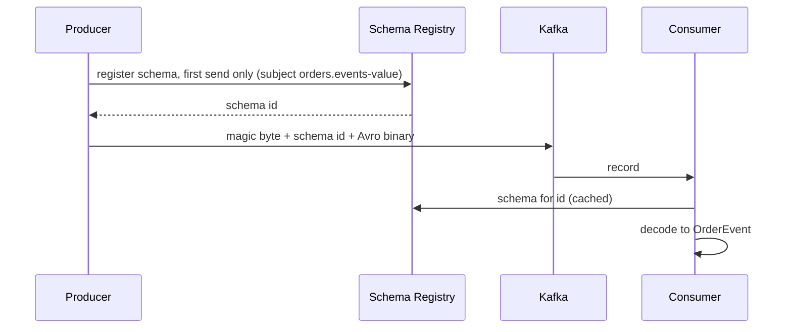

A record's value on the wire:

```mermaid
flowchart LR
    m["magic byte<br/>0"] --- id["schema id<br/>4 bytes"] --- body["Avro binary<br/>no field names"]
```

**Compatibility `FORWARD_TRANSITIVE`:** consumers on **any** older schema can read the new one, so producers can upgrade first.

```mermaid
flowchart LR
    P2["producer on v2"] --> K{{topic}} --> C1["consumer on v1 ✅"]
    K --> C2["consumer on v2 ✅"]
```

| Change | Accepted? |
|---|---|
| Add a field | ✅ old consumers ignore it |
| Remove a field that has a default | ✅ old consumers use the default |
| Remove a field without a default, change a type incompatibly | ❌ rejected at registration |

- Optional fields are unions with a default, e.g. `reason: ["null", "string"]`, default `null`.
- A record that does not match its schema is a poison pill → DLT ([3](#3-retries--dlq)).

## Run

Requires Docker (your user in the `docker` group), Java 21, Maven 3.9, `make`; `curl` and `jq` for `make demo`, Node 18+ for `make ui`.

### Quick start

```bash
make start
```

This one command starts the infrastructure in Docker (Kafka, Schema Registry, PostgreSQL, Kafka UI), builds every module, starts the three services as local JVMs, waits until they are all healthy, then serves the scenario UI on http://localhost:5173. `Ctrl+C` stops the UI only; the services keep running until `make down`.

Without the UI, `make up` does the same and returns; run `make demo` for the scenarios in the terminal.

To run the services from your IDE instead, start only the infrastructure with `make infra`, then run each `*Application` class.

### All targets

```bash
make start  # make up, then make ui
make up     # infrastructure in Docker, services as local JVMs (logs in logs/)
make demo   # end-to-end scenarios
make ui     # scenario UI with each order's path through the services and topics: http://localhost:5173
make logs
make down   # stop the services and reset the infrastructure
make test   # starts the compose PostgreSQL; tests use the *_test databases
```

| Demo | Result |
|---|---|
| Order 2 (stock 5) | `CONFIRMED` |
| Order 10 | `REJECTED` |
| Customer `flaky_*` | retried, then notified |
| Customer `invalid_*` | sent to DLT |

| URL | |
|---|---|
| Scenario UI | http://localhost:5173 (`make ui`) |
| Orders | http://localhost:8080/api/orders (`/outbox/pending`) |
| Inventory | http://localhost:8082/api/inventory |
| Kafka UI | http://localhost:8090 |
| Schema Registry | http://localhost:8081 |
| Kafka | localhost:9092, 9094, 9095, 9096 |
| PostgreSQL | localhost:5432 (postgres / postgres) |
