# Kafka & Spring Boot — Event-Driven Order System

An e-commerce order system built from **three Spring Boot microservices** that never call each other directly: they communicate **only through Kafka**, with **Avro** contracts enforced by **Schema Registry**. Each service owns its **own PostgreSQL database**, and every event leaves a service through a **Transactional Outbox**.

The project is a teaching support: each reliability pattern (outbox, saga, idempotent consumer, retries, dead-letter topics) is implemented once, in a small amount of code, and can be demonstrated end to end with `make demo`.

---

## Table of contents

1. [The big picture](#1-the-big-picture)
2. [Components](#2-components)
3. [The role Kafka plays](#3-the-role-kafka-plays)
4. [Databases](#4-databases)
5. [The Transactional Outbox](#5-the-transactional-outbox)
6. [The order saga, step by step](#6-the-order-saga-step-by-step)
7. [Idempotent consumers](#7-idempotent-consumers)
8. [Error handling: retries and dead-letter topics](#8-error-handling-retries-and-dead-letter-topics)
9. [Avro contracts and Schema Registry](#9-avro-contracts-and-schema-registry)
10. [Running the project](#10-running-the-project)
11. [Configuration](#11-configuration)
12. [Project layout](#12-project-layout)

---

## 1. The big picture

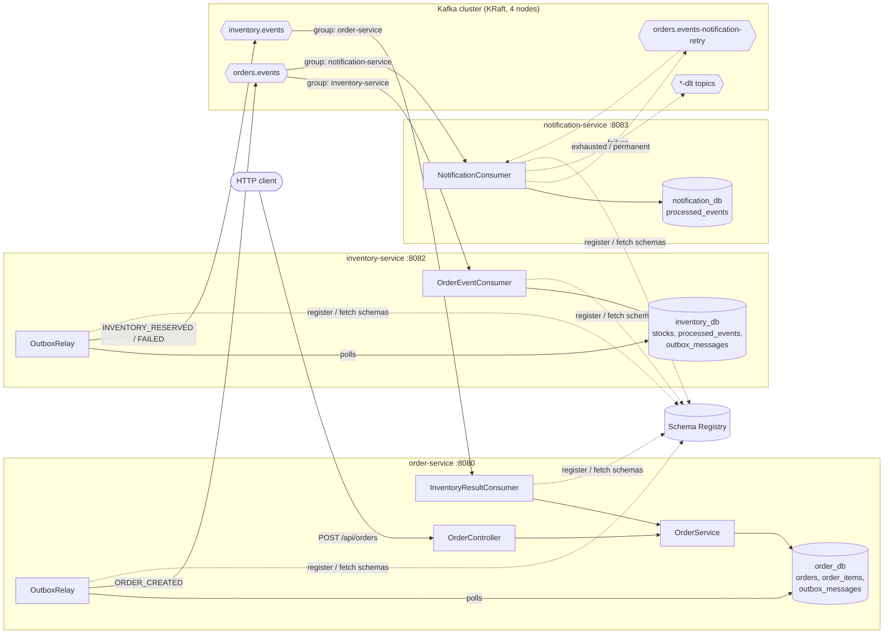

**In one sentence:** a client creates an order; the order service saves it and its `ORDER_CREATED` event atomically; Kafka delivers the event to the inventory service (which reserves stock and answers on `inventory.events`) and to the notification service (which notifies the customer); the order service consumes the answer and moves the order to `CONFIRMED` or `REJECTED`.

---

## 2. Components

### Application services

| Service | Port | Produces | Consumes | Database | What it does |
|---|---|---|---|---|---|
| **order-service** | 8080 | `orders.events` (via outbox) | `inventory.events` | `order_db` | REST API for orders. Creates an order in state `CREATED`, emits `ORDER_CREATED`, then applies the inventory result (`CONFIRMED` / `REJECTED`). Saga **initiator**. |
| **inventory-service** | 8082 | `inventory.events` (via outbox) | `orders.events` | `inventory_db` | Holds product stock. For each `ORDER_CREATED`, reserves **all lines or none** and emits `INVENTORY_RESERVED` or `INVENTORY_FAILED`. Saga **participant**. |
| **notification-service** | 8083 | — (only retry/DLT topics) | `orders.events` | `notification_db` | Notifies the customer of each new order. Demonstrates **non-blocking retries** with a retry topic and a DLT. |

#### order-service

| Class | Role |
|---|---|
| [OrderController](order-service/src/main/java/com/example/kafka/order/controller/OrderController.java) | `POST /api/orders`, `GET /api/orders`, `GET /api/orders/{id}`, and `GET /api/orders/outbox/pending` to inspect events not yet published. |
| [OrderService](order-service/src/main/java/com/example/kafka/order/service/OrderService.java) | `createOrder`: saves the order **and** enqueues the event in one transaction. `applyInventoryResult`: saga step, idempotent through the order state machine. |
| [InventoryResultConsumer](order-service/src/main/java/com/example/kafka/order/consumer/InventoryResultConsumer.java) | `@KafkaListener` on `inventory.events`, delegates to `OrderService`. |
| `Order`, `OrderItemEntity` | JPA entities for `orders` / `order_items`. |

#### inventory-service

| Class | Role |
|---|---|
| [OrderEventConsumer](inventory-service/src/main/java/com/example/kafka/inventory/consumer/OrderEventConsumer.java) | `@KafkaListener` on `orders.events`. Deduplicates, row-locks the stocks, reserves, writes the result to the outbox — all in one DB transaction. |
| [StockRepository](inventory-service/src/main/java/com/example/kafka/inventory/repository/StockRepository.java) | `lockAll`: `SELECT … FOR UPDATE` in a stable order, so concurrent orders cannot oversell and cannot deadlock. |
| [InventoryController](inventory-service/src/main/java/com/example/kafka/inventory/controller/InventoryController.java) | `GET /api/inventory`, `GET /api/inventory/{productId}`, `POST /api/inventory/{productId}/init?quantity=N`. |

#### notification-service

| Class | Role |
|---|---|
| [NotificationConsumer](notification-service/src/main/java/com/example/kafka/notification/consumer/NotificationConsumer.java) | `@RetryableTopic` + `@KafkaListener` on `orders.events`. Simulates a provider: customers prefixed `flaky_` fail twice then succeed, `invalid_` fail permanently. `@DltHandler` logs dead letters. |

### Shared modules

| Module | Contents |
|---|---|
| **avro-schemas** | `.avsc` contracts ([OrderEvent](avro-schemas/src/main/avro/OrderEvent.avsc), [InventoryResultEvent](avro-schemas/src/main/avro/InventoryResultEvent.avsc)); Java classes are generated at build time. |
| **common** | [OutboxWriter](common/src/main/java/com/example/kafka/common/outbox/OutboxWriter.java), [OutboxRelay](common/src/main/java/com/example/kafka/common/outbox/OutboxRelay.java), [AvroCodec](common/src/main/java/com/example/kafka/common/outbox/AvroCodec.java), the `OutboxMessage` / `ProcessedEvent` entities, [KafkaErrorHandlingConfig](common/src/main/java/com/example/kafka/common/kafka/KafkaErrorHandlingConfig.java), [KafkaTopics](common/src/main/java/com/example/kafka/common/constant/KafkaTopics.java), the shared Flyway migration `V1` and [common-defaults.yml](common/src/main/resources/common-defaults.yml). |

### Infrastructure (`docker-compose.yml`)

| Container | Image | Role |
|---|---|---|
| `kafka-1`, `kafka-2`, `kafka-3` | `apache/kafka:3.7.0` | Broker **and** KRaft controller (they form the 3-voter metadata quorum). |
| `kafka-4` | `apache/kafka:3.7.0` | Broker only (stores data, does not vote). |
| `kafka-init` | `apache/kafka:3.7.0` | One-shot job: creates every topic, then exits. |
| `schema-registry` | `confluentinc/cp-schema-registry:7.7.1` | Stores Avro schemas, enforces `FORWARD_TRANSITIVE` compatibility. |
| `postgres` | `postgres:16-alpine` | One server, three databases (`order_db`, `inventory_db`, `notification_db`). |
| `kafka-ui` | `kafbat/kafka-ui:v1.0.0` | Web UI to browse topics, messages, consumer groups and schemas. |

---

## 3. The role Kafka plays

Kafka is the **only** communication channel between services. It gives the system:

- **Decoupling** — the order service doesn't know who listens to `orders.events`. Notification was added without touching order-service.
- **Durability** — events are replicated on 3 brokers; a consumer that is down catches up from its committed offset when it restarts.
- **Fan-out** — each service reads with its own **consumer group** (`group-id = spring.application.name`), so inventory and notification each receive *every* `orders.events` message independently.
- **Per-order ordering** — every message is keyed by `orderId`, so all events of one order go to the same partition and are read in order.
- **Scalability** — 3 partitions per topic: up to 3 instances of each service can consume in parallel.

### Cluster topology

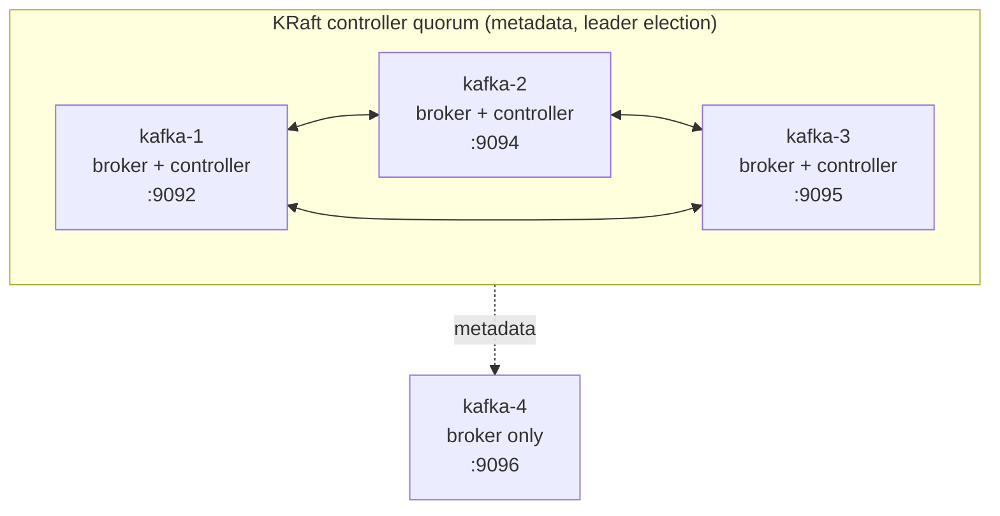

No ZooKeeper: cluster metadata is managed by the Raft quorum of `kafka-1..3`. The cluster survives the loss of one controller (2 of 3 votes remain).

### Topics

| Topic | Partitions × RF | Producer | Consumer group(s) | Content |
|---|---|---|---|---|
| `orders.events` | 3 × 3 | order-service (outbox) | `inventory-service`, `notification-service` | `OrderEvent` (`ORDER_CREATED`) |
| `inventory.events` | 3 × 3 | inventory-service (outbox) | `order-service` | `InventoryResultEvent` (`INVENTORY_RESERVED` / `INVENTORY_FAILED`) |
| `orders.events-dlt` | 3 × 3 | error handler of inventory-service | — (inspection) | `orders.events` records that failed 3 times |
| `inventory.events-dlt` | 3 × 3 | error handler of order-service | — (inspection) | `inventory.events` records that failed 3 times |
| `orders.events-notification-retry` | 3 × 3 | notification-service | `notification-service` | Notifications waiting for a retry |
| `orders.events-notification-dlt` | 3 × 3 | notification-service | `notification-service` (`@DltHandler`) | Notifications that failed for good |

Topic auto-creation is disabled on the brokers; `kafka-init` creates exactly this list.

### Keys, partitions and ordering

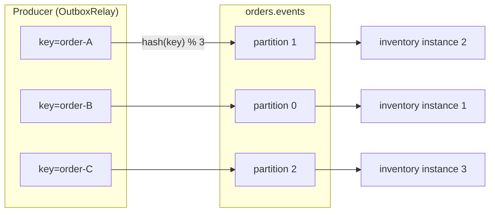

All events of `order-A` land on partition 1, so they are consumed by one instance, in order.

### Durability settings

| Setting | Value | Effect |
|---|---|---|
| `replication-factor` | 3 | Each partition has a leader and two followers on different brokers. |
| `min.insync.replicas` | 2 | A write is accepted only when at least 2 replicas have it. |
| producer `acks` | `all` | The producer waits for all in-sync replicas → no loss if a broker dies right after an ack. |
| producer idempotence | on (default with `acks=all`) | Producer retries don't create duplicates or reorder a partition. |
| consumer `auto-offset-reset` | `earliest` | A new consumer group reads the topic from the beginning. |

---

## 4. Databases

The **database-per-service** pattern: one PostgreSQL server, but each service has its own database and never reads another service's tables. The only way to learn about another service's data is through its events.

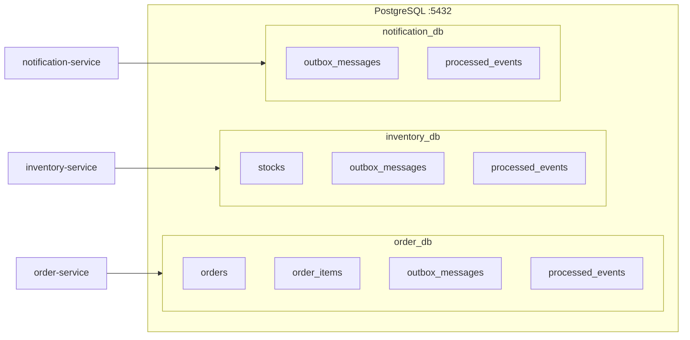

Schemas are managed by **Flyway**; Hibernate only validates (`ddl-auto: validate`).

- `common/src/main/resources/db/common/V1__outbox_and_idempotency.sql` — shared by every service: `outbox_messages` and `processed_events`.
- `<service>/src/main/resources/db/migration/V2__*.sql` — the service's own business tables.

### Tables

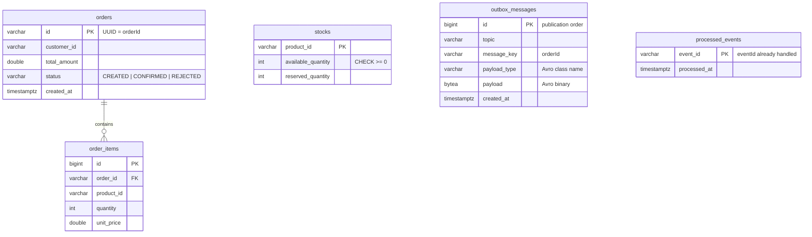

| Table | Used by | Purpose |
|---|---|---|
| `orders`, `order_items` | order-service | Business data of an order. |
| `stocks` | inventory-service | Available and reserved quantity per product. |
| `outbox_messages` | order-service, inventory-service | Events waiting to be published (see §5). Present in `notification_db` too because V1 is shared, but unused there (`app.outbox.enabled` is off). |
| `processed_events` | inventory-service, notification-service | IDs of events already handled, for deduplication (see §7). |

---

## 5. The Transactional Outbox

### The problem: dual writes

A service that must both **update its database** and **publish an event** cannot do it atomically: the database and Kafka are two separate systems.

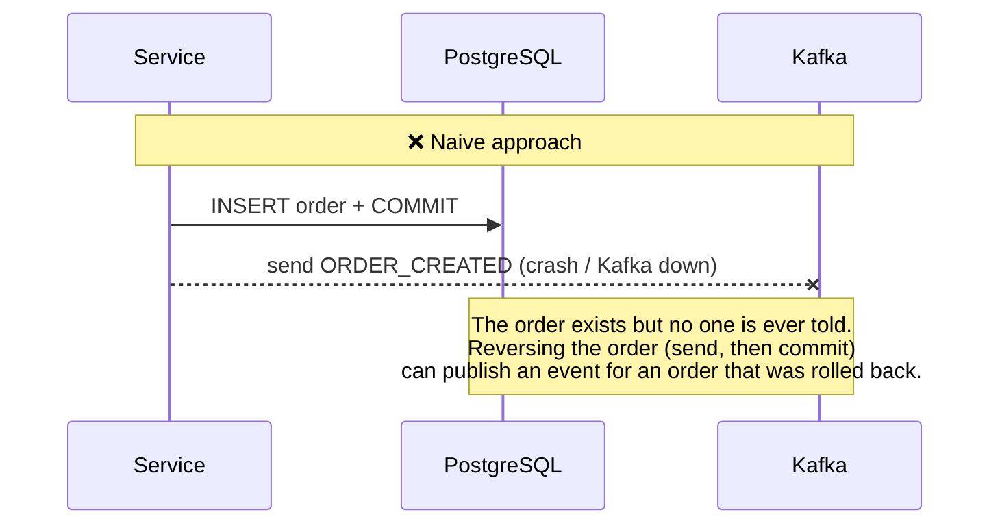

### The solution: write the event to the database, publish later

The event is written to an `outbox_messages` table **in the same local transaction** as the business change. Either both are committed, or neither. A separate background task, the **relay**, then copies the rows to Kafka.

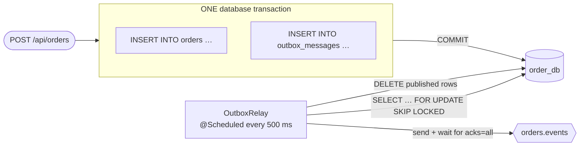

### How it is implemented

**1. Writing — [OutboxWriter](common/src/main/java/com/example/kafka/common/outbox/OutboxWriter.java)**

```java
@Transactional(propagation = Propagation.MANDATORY)   // fails if there is no surrounding transaction
public void enqueue(String topic, String key, SpecificRecord event) {
    repository.save(new OutboxMessage(topic, key, event.getClass().getName(), AvroCodec.encode(event)));
}
```

`MANDATORY` guarantees the event can only be written as part of the caller's business transaction. The Avro record is stored as binary (`payload`) together with its class name (`payload_type`) so it can be decoded later.

**2. Relaying — [OutboxRelay](common/src/main/java/com/example/kafka/common/outbox/OutboxRelay.java)** (enabled by `app.outbox.enabled=true`)

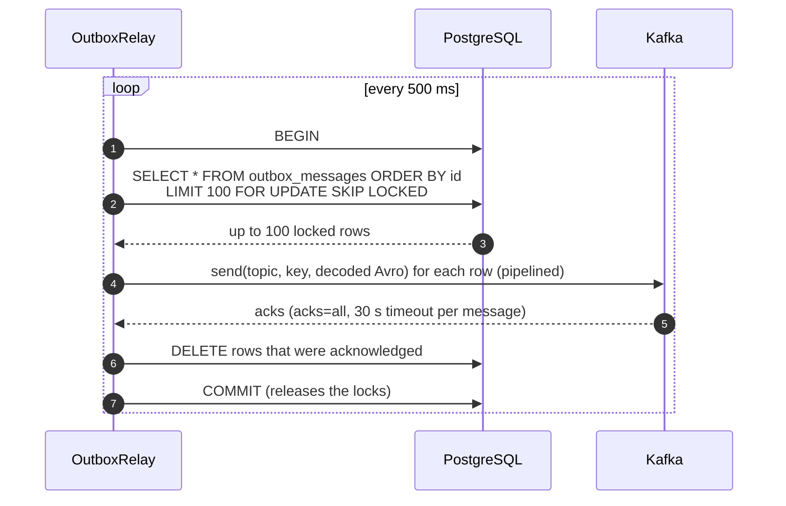

| Detail | Why |
|---|---|
| `ORDER BY id` | Rows are published in insertion order. |
| `FOR UPDATE SKIP LOCKED` | Several instances of a service can run the relay in parallel: each one locks a different batch, so no row is sent twice by two instances. |
| Send the whole batch, then wait | The producer pipelines the batch instead of a round-trip per message; the idempotent producer keeps per-partition order. |
| Delete only acknowledged rows | A row whose send failed or timed out stays in the table and is retried on the next poll. |
| Everything in one transaction | A row is either *published and deleted*, or *kept for retry*. |

### Delivery guarantee: at-least-once

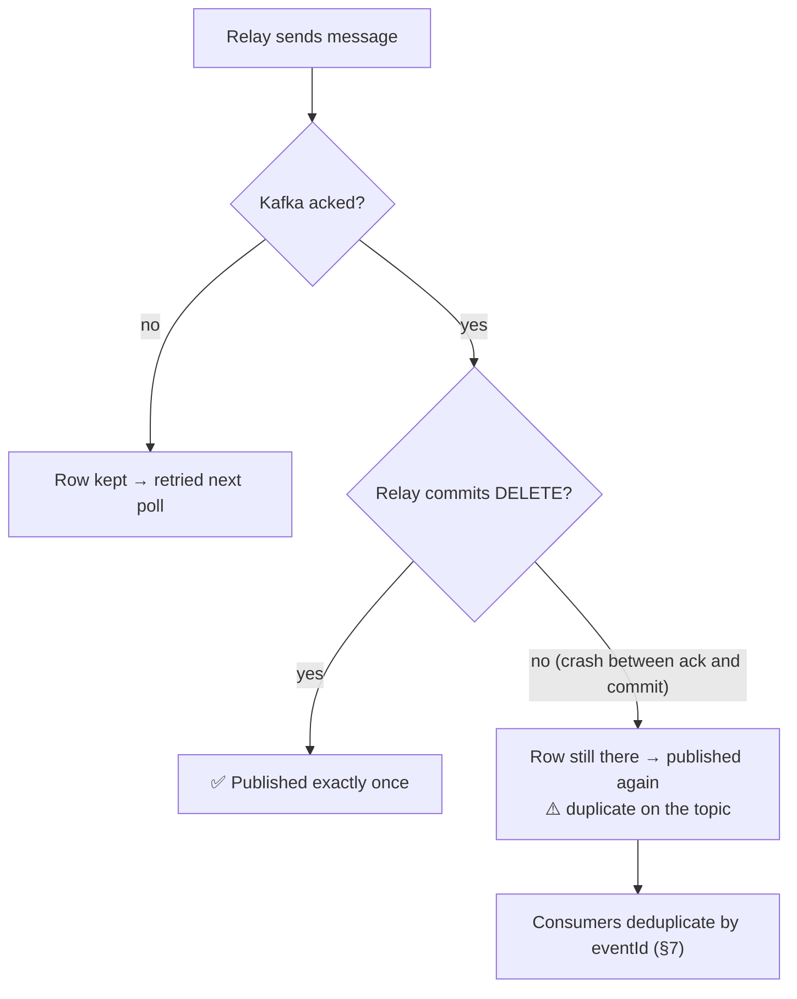

The outbox never **loses** an event, but in a rare crash window it can publish one **twice**. The `eventId` is part of the stored payload, so the duplicate carries the same ID and consumers can safely discard it. **Outbox + idempotent consumer = effectively-once processing.**

You can watch the outbox in action: `GET http://localhost:8080/api/orders/outbox/pending` lists rows not yet published (usually empty; stop Kafka to see it fill up, restart it to see it drain).

---

## 6. The order saga, step by step

A **choreographed saga**: there is no central orchestrator, each service reacts to events and publishes its own.

### Happy path

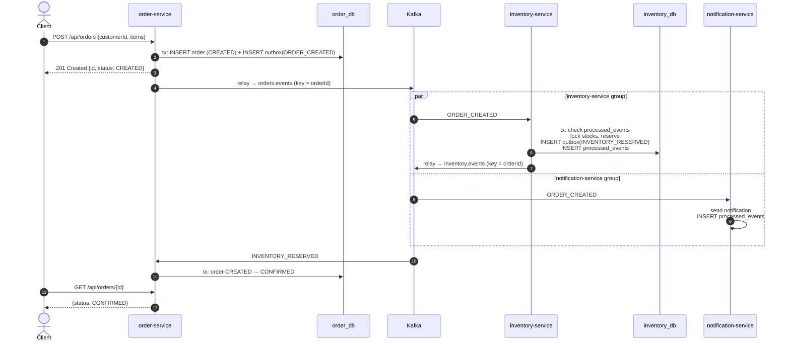

The `POST` returns immediately with `CREATED`: the final status is reached **asynchronously**, a few hundred milliseconds later.

### Order state machine

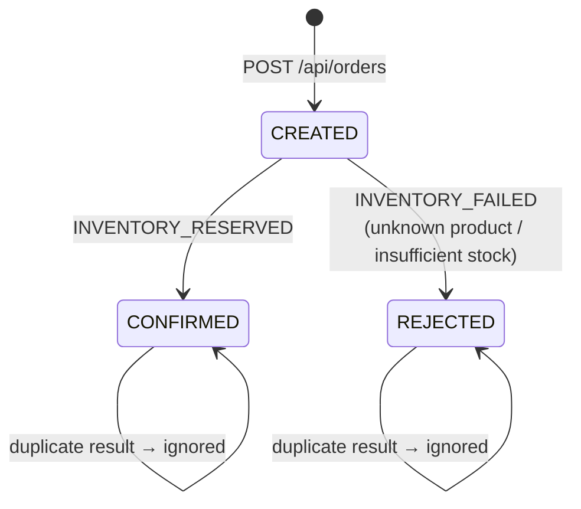

### Inventory decision

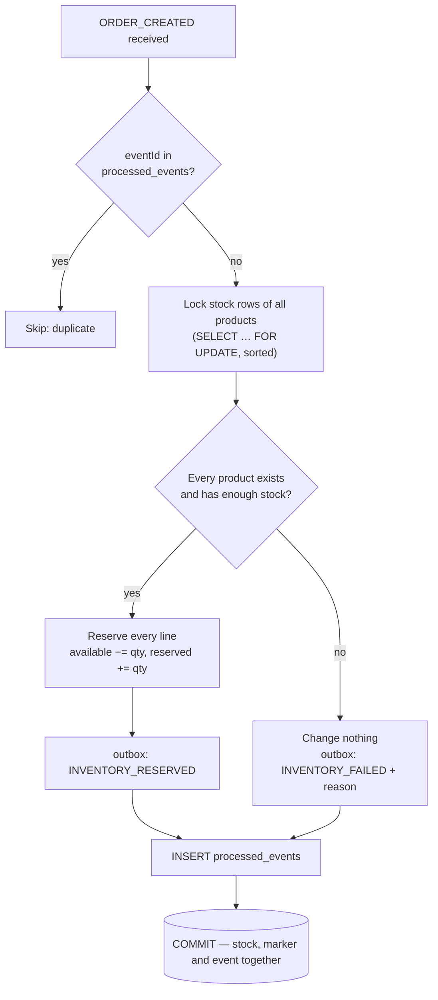

Because the reservation is all-or-nothing inside a single service, a failed order needs no compensating action: nothing was reserved.

---

## 7. Idempotent consumers

Kafka (and the outbox) deliver **at least once**, so every consumer must tolerate receiving the same event twice. Two techniques are used:

| Service | Technique | How |
|---|---|---|
| inventory-service | **Processed-events table** | `processed_events.event_id` is checked first and inserted in the **same transaction** as the stock change and the outbox row. |
| notification-service | **Processed-events table** | Same table, inserted after a successful send. |
| order-service | **State machine** | Only a `CREATED` order can transition; a second result for a `CONFIRMED`/`REJECTED` order is a no-op. |

Why it is safe even when a service crashes:

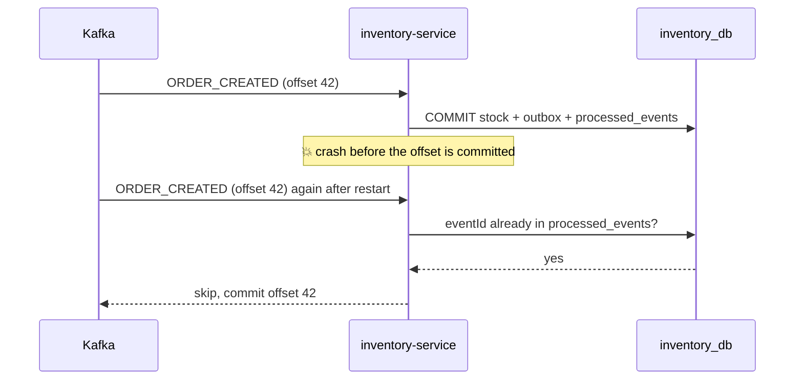

The Kafka offset is committed by the listener container only **after** the method returns. If the crash happens before the DB commit, nothing was written and the redelivery is processed normally; if it happens after, the redelivery is detected and skipped.

---

## 8. Error handling: retries and dead-letter topics

Two strategies are shown side by side.

### Blocking retries → `<topic>-dlt` (order-service, inventory-service)

Configured once in [KafkaErrorHandlingConfig](common/src/main/java/com/example/kafka/common/kafka/KafkaErrorHandlingConfig.java) and applied to every plain `@KafkaListener`.

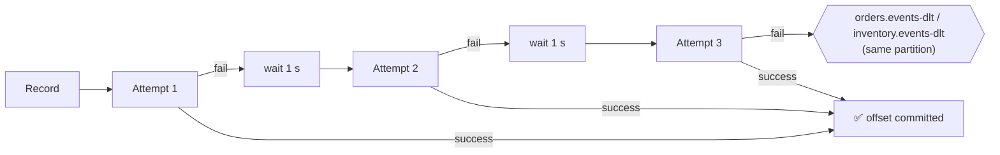

- `FixedBackOff(1000 ms, 2 retries)` → 3 attempts in total.
- The partition is **blocked** during the retries (strict ordering is preserved).
- **Poison pills** — messages that cannot even be deserialized — are caught by `ErrorHandlingDeserializer` and forwarded to the DLT as raw bytes, instead of looping forever in `poll()`.

### Non-blocking retries → retry topic → DLT (notification-service)

Configured with `@RetryableTopic` on [NotificationConsumer](notification-service/src/main/java/com/example/kafka/notification/consumer/NotificationConsumer.java).

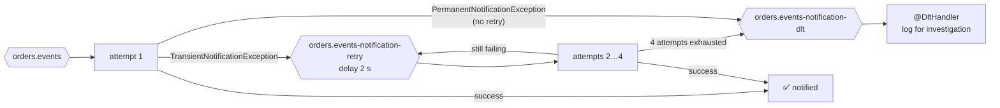

- The failed record is moved to another topic, so the **main partition keeps flowing** — other customers are not delayed by one slow provider.
- `PermanentNotificationException` (e.g. invalid customer) skips the retries entirely.
- Trade-off: ordering between a retried record and later ones is no longer guaranteed — acceptable for notifications, not for stock reservations.

| | Blocking (`DefaultErrorHandler`) | Non-blocking (`@RetryableTopic`) |
|---|---|---|
| Used by | order, inventory | notification |
| Order preserved | ✅ yes | ❌ no |
| Other messages delayed | ❌ yes, partition is stuck | ✅ no |
| Final destination | `<topic>-dlt` | `orders.events-notification-dlt` |

---

## 9. Avro contracts and Schema Registry

Events are defined as Avro schemas in [avro-schemas/src/main/avro](avro-schemas/src/main/avro); Maven generates the Java classes (`com.example.kafka.avro.OrderEvent`, `InventoryResultEvent`, `OrderItem`).

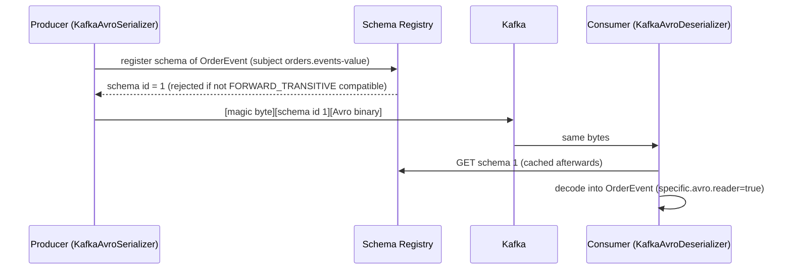

| Event | Topic | Key fields |
|---|---|---|
| `OrderEvent` | `orders.events` | `eventId`, `eventType`, `occurredAt`, `orderId`, `customerId`, `totalAmount`, `status`, `items[]` |
| `InventoryResultEvent` | `inventory.events` | `eventId`, `eventType`, `occurredAt`, `orderId`, `success`, `reason` (nullable) |

The registry enforces **`FORWARD_TRANSITIVE`** compatibility: data written with a new schema must be readable by consumers using **any** previous version. Producers can therefore be upgraded before consumers (e.g. adding an optional field with a default).

---

## 10. Running the project

**Prerequisites:** Docker (user in the `docker` group), Java 21, Maven 3.9, `make`; `curl` and `jq` for the demo.

```bash
make up      # infrastructure + the three services in containers
make demo    # end-to-end scenarios
make logs    # follow the services' logs
make down    # stop everything (no volumes: state is reset)
```

To develop from the IDE: `make infra`, then run `OrderApplication`, `InventoryApplication` and `NotificationApplication` (or `mvn -pl order-service spring-boot:run`). Tests (`make test`) don't need Docker: they use embedded Kafka, H2 and a `mock://` Schema Registry.

### Demo scenarios (`scripts/demo.sh`)

| # | Scenario | Expected result |
|---|---|---|
| 1 | Order 2 × `PROD-1` (stock 5) | `CONFIRMED`, stock becomes 3 available / 2 reserved |
| 2 | Order 10 × `PROD-1` | `REJECTED` (insufficient stock), stock unchanged |
| 3 | Customer `flaky_carol` | Notification fails twice, goes through the retry topic, then succeeds |
| 4 | Customer `invalid_dave` | Notification goes straight to `orders.events-notification-dlt` |

Try it manually:

```bash
curl -X POST "localhost:8082/api/inventory/PROD-1/init?quantity=5"
curl -X POST localhost:8080/api/orders -H 'Content-Type: application/json' \
  -d '{"customerId":"alice","items":[{"productId":"PROD-1","quantity":2,"unitPrice":10.0}]}'
curl localhost:8080/api/orders/<id>        # CREATED, then CONFIRMED a moment later
```

### URLs

| Service | URL |
|---|---|
| order-service | http://localhost:8080/api/orders (`/outbox/pending` for the outbox) |
| inventory-service | http://localhost:8082/api/inventory (`POST /{productId}/init?quantity=N`) |
| notification-service | http://localhost:8083/actuator/health |
| Kafka UI | http://localhost:8090 |
| Schema Registry | http://localhost:8081 |
| Kafka (from host) | localhost:9092, 9094, 9095, 9096 |
| PostgreSQL | localhost:5432 (postgres / postgres) |

---

## 11. Configuration

- **Infrastructure** — `docker-compose.yml` only. 4-node KRaft cluster (3 broker+controller, 1 broker), RF 3, `min.insync.replicas=2`, topic auto-creation disabled. All topics are created by `kafka-init`.
- **Services** — shared settings (Kafka, Avro, datasource, JPA, Flyway) live in [common-defaults.yml](common/src/main/resources/common-defaults.yml). Each `application.yml` only sets the name, port, database (`app.database`) and `app.outbox.enabled`.
- **Environment variables** (defaults work from the host): `KAFKA_BOOTSTRAP_SERVERS`, `SCHEMA_REGISTRY_URL`, `POSTGRES_HOST`, `POSTGRES_PORT`, `POSTGRES_USER`, `POSTGRES_PASSWORD`.
- **SQL schema** — Flyway migrations (`db/common/V1` shared, `db/migration/V2+` per service); Hibernate in `validate` mode.
- **Adding a topic** — add a constant to `KafkaTopics` and the topic to the `kafka-init` list (plus its `-dlt` if it is consumed).

---

## 12. Project layout

```
kafka-java/
├── avro-schemas/            Avro contracts (.avsc) → generated Java classes
├── common/                  Outbox, idempotency entities, Kafka error handling, shared config & V1 migration
├── order-service/           REST API + saga initiator            (order_db)
├── inventory-service/       Stock reservation, saga participant  (inventory_db)
├── notification-service/    Notifications with retry topic + DLT (notification_db)
├── infrastructure/postgres/ init.sql: creates the three databases
├── scripts/demo.sh          End-to-end scenarios
├── docker-compose.yml       Kafka (KRaft ×4), Schema Registry, PostgreSQL, Kafka UI, services
├── Dockerfile               Builds any service (MODULE build arg)
└── Makefile                 make help / infra / up / down / logs / build / test / demo
```
