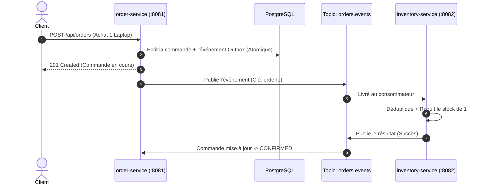

# 01 - Le Scénario Métier (Comment ça marche)

[⬅️ Sommaire](file:///home/abdelhadi/Documents/kafka-java/docs/00-index.md) | [Fiche Suivante : Les Configurations ➡️](file:///home/abdelhadi/Documents/kafka-java/docs/02-configurations-cles.md)

---

## Le Cas d'Usage : Commander un Produit

Le projet simule un site e-commerce avec 2 services principaux :

1. **`order-service`** : reçoit la commande depuis le site web.
2. **`inventory-service`** : vérifie et réserve le stock en magasin.

---

## Pourquoi Kafka ici ?

* **Découplage** : Si le service de stock est temporairement éteint ou redémarre, le service de commande continue de fonctionner sans bloquer l'acheteur.
* **Mise en file d'attente automatique** : Kafka garde les événements sur disque jusqu'à ce que les consommateurs soient prêts.
* **Ordre garanti** : Grâce à la clé `orderId`, toutes les actions concernant une même commande arrivent dans le bon ordre.
