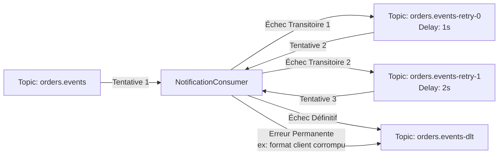

# 11 - Retries Non-Bloquants et Dead Letter Topics (DLT)

[⬅️ Précédent : Évolution des Schémas](file:///home/abdelhadi/Documents/kafka-java/docs/10-evolution-des-schemas-et-forward-transitive.md) | [Suivant : Idempotence & Déduplication ➡️](file:///home/abdelhadi/Documents/kafka-java/docs/12-idempotence-et-deduplication.md)

---

## 1. Le Danger des Retries Bloquants en Tête de File (*Head-of-Line Blocking*)

Dans une boucle de consommation Kafka classique, si un message échoue et que vous appliquez un retry bloquant sur place (`Thread.sleep(5000)`) :
- **Toute la partition est gelée.**
- Aucun des milliers de messages sains situés après le message en échec ne peut être traité.
- Si le délai dépasse `max.poll.interval.ms`, Kafka considère le consommateur mort et déclenche un rebalancing en boucle.

---

## 2. La Solution : Retries Non-Bloquants avec `@RetryableTopic`

Dans `notification-service`, nous utilisons la fonctionnalité moderne de Spring Kafka pour orchestrer une cascade de topics de retry :

### Distinction Essentielle des Types d'Erreurs :
1. **Erreurs Transitoires (`TransientNotificationException`)** : Panne réseau momentanée, timeout API tiers. On applique un backoff exponentiel pour laisser au service distant le temps de guérir.
2. **Erreurs Permanentes (`PermanentNotificationException`)** : Données invalides, format corrompu, bug de logique. **Ne pas retenter !** Le message est immédiatement dérouté vers la Dead Letter Topic sans gaspiller de CPU ni de bande passante.

---

## 3. Le Compromis Incontournable : Désordonnancement

> **Attention Architecturale :**
> Dès lors qu'un message en échec est dérivé vers un topic de retry distinct, les messages suivants de la partition d'origine continuent d'être consommés.
> **L'ordre strict des événements peut donc être temporairement altéré.**
> Si le domaine métier exige un ordre absolu inconditionnel, le traitement doit être mis en pause ou dérouté vers un mécanisme de quarantaine par clé d'entité.
