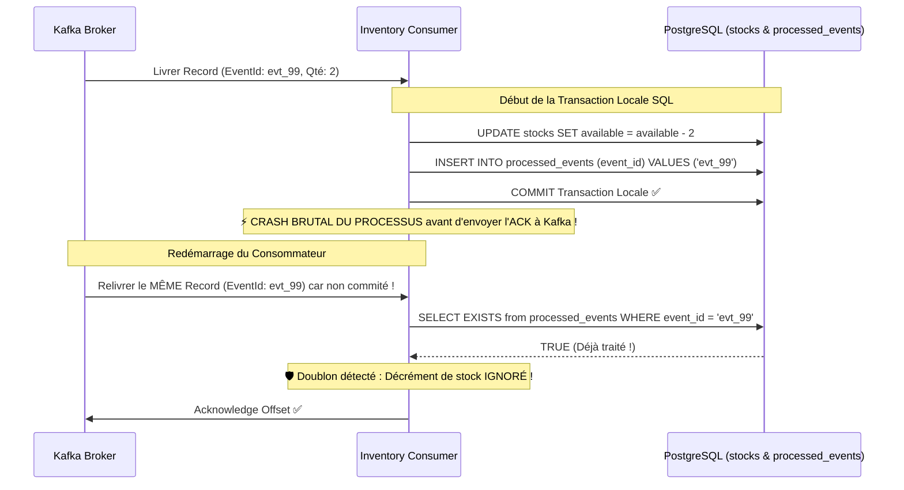

# 12 - Idempotence et Déduplication Métier

[⬅️ Précédent : Retries & DLT](file:///home/abdelhadi/Documents/kafka-java/docs/11-retries-et-dead-letter-topics.md) | [Suivant : Transactions & Exactly-Once ➡️](file:///home/abdelhadi/Documents/kafka-java/docs/13-transactions-et-exactly-once.md)

---

## 1. Pourquoi la Déduplication en Mémoire est Insuffisante

Certains développeurs tentent de dédupliquer les messages avec un simple `Set<String>` ou un cache en mémoire (ex: Guava Cache) :
- En cas de redémarrage ou de mise à l'échelle horizontale (plusieurs pods Kubernetes), **la mémoire est perdue ou non partagée**.
- Deux instances consommant le même message (après un rebalance) exécuteraient l'action métier deux fois.

---

## 2. Le Scénario Réel de Duplication (Crash Post-Traitement)



---

## 3. Implémentation dans notre Code Réel

Dans [`com.example.kafka.common.entity.ProcessedEvent`](file:///home/abdelhadi/Documents/kafka-java/common/src/main/java/com/example/kafka/common/entity/ProcessedEvent.java) :
- La colonne `event_id` est la clé primaire unique (`@Id`).
- Dans [`OrderEventConsumer.java`](file:///home/abdelhadi/Documents/kafka-java/inventory-service/src/main/java/com/example/kafka/inventory/consumer/OrderEventConsumer.java) :
  ```java
  if (processedEventRepository.existsById(eventId)) {
      log.warn("Doublon détecté : action métier ignorée !");
      ack.acknowledge();
      return;
  }
  // Exécution de l'effet métier + sauvegarde idempotence dans la même transaction
  processedEventRepository.save(new ProcessedEvent(eventId, ...));
  ```
L'opération est rigoureusement **idempotente** : consommer le message 1 fois ou 100 fois produit exactement le même état final dans la base de données.
