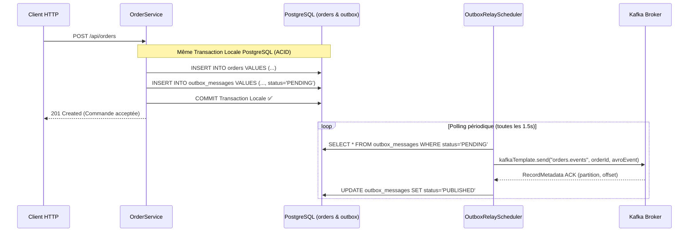

# 14 - Le Pattern Transactional Outbox

[⬅️ Précédent : Transactions & Exactly-Once](file:///home/abdelhadi/Documents/kafka-java/docs/13-transactions-et-exactly-once.md) | [Suivant : Listen to Yourself & Consistance ➡️](file:///home/abdelhadi/Documents/kafka-java/docs/15-listen-to-yourself-et-consistance.md)

---

## 1. Le Problème de la Double Écriture (*Dual-Write Problem*)

Dans une architecture distribuée, vouloir exécuter séquentiellement :
```java
orderRepository.save(order);      // 1. Écriture en Base de données
kafkaTemplate.send("orders", ...); // 2. Écriture dans Kafka
```
est une faute de conception majeure. Si le serveur plante ou redémarre entre la ligne 1 et la ligne 2, votre base contient la commande mais le reste du système ne le saura jamais.

---

## 2. Fonctionnement du Transactional Outbox

Le pattern résout ce problème en tirant parti du moteur transactionnel ACID de la base de données locale (PostgreSQL) :



---

## 3. Pourquoi l'Outbox N'élimine PAS les Doublons

> **Rappel fondamental :**
> L'Outbox garantit l'**Atomicité** entre la base et l'intention de publication.
> En revanche, l'Outbox est un mécanisme de livraison **At-Least-Once** :
> Si le Relay publie le message avec succès sur Kafka, mais que le pod crash avant de pouvoir faire l'`UPDATE status = 'PUBLISHED'` en base, le Relay relancera la publication au redémarrage !
> C'est pour cette raison exacte que le récepteur (`inventory-service`) doit implémenter une table de déduplication (`processed_events`).

---

## 4. Comparaison : Relay Applicatif vs CDC Debezium

| Critère | Relay Applicatif (implémenté ici) | CDC Debezium |
|---|---|---|
| **Complexité d'infrastructure** | Très simple (aucun composant tiers supplémentaire). | Requiert Kafka Connect, connecteur Debezium, droits `wal_level=logical`. |
| **Latence** | Dépend du fixedDelay (ex: 1 seconde). | Quasi temps réel (lecture directe du Write-Ahead Log PostgreSQL). |
| **Impact sur la base** | Requêtes `SELECT ... WHERE status='PENDING'`. | Lecture passive du flux de réplication sans requêtes SELECT. |
